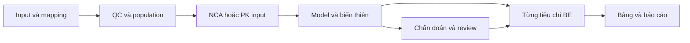

# Khảo sát mẫu Certara Phoenix và đề xuất cải tiến BE_app

Ngày khảo sát: **30/10/2026**, Australia/Perth. Phoenix đang cài: **8.8.0.20523**, cửa sổ hiển thị Academic Use Only. App: engine **0.3.0**.

## 1. Kết quả chính

Ưu tiên của BE_app nên là **làm rõ căn cứ của từng kết luận và mở rộng kiểm chứng replicate bằng dữ liệu độc lập**. App đã có ABE, EMA Method A/ABEL, FDA HVD/NTI, các bảng ANOVA, LS means, phương sai, subject contrasts và thành phần Howe. Vì vậy, chỉ thêm các bảng mang tên Phoenix sẽ tạo ít giá trị hơn việc nối kết chúng thành một luồng kiểm tra được.

Ba việc nên làm trước:

1. Sửa biểu đồ GMR/CI đang dùng giới hạn cố định 80–125% cho mọi endpoint.
2. Thu thập bộ đầu vào/kết quả tham chiếu từ các project EMA ABEL, FDA HVD và FDA NTI để benchmark riêng từng mô hình và population.
3. Bổ sung bảng population theo endpoint và bảng kết luận từng tiêu chí, liên kết trực tiếp tới dữ liệu và phép tính trung gian.

Individual BE, Population BE và in vitro BE là các hướng mở rộng riêng. Khảo sát này chưa cung cấp căn cứ để đưa các phương pháp đó vào luồng kết luận nghiên cứu hiện hành.

## 2. Phạm vi và cách khảo sát

Nguồn:

```text
D:\Sync\OneDrive - Curtin\Asean ACTD-ACTR training\Tap huan doanh nghiep\NIDQC\Shared\Certara Phoenix Templates
```

Đã mở **cả 8 file `.phxproj`** bằng giao diện Phoenix, mở rộng cây workflow và đọc các nút xử lý. Với EMA ABEL và FDA NTI, đã xem thêm bảng kết quả cuối đang lưu trong project. Với replicate cơ bản, đã xem thêm đối tượng BE và lựa chọn reference. Đây là khảo sát cấu trúc và kết quả đã lưu; **chưa thực thi lại toàn bộ các project Phoenix hoặc đối chiếu số học các project mới với app**.

Đã đọc mã nguồn app về domain, nhập dữ liệu, NCA, BE, replicate, bảng xuất, snapshot, pipeline và UI. Đã chạy lại hai script benchmark sẵn có. Không thực hiện thay đổi thuật toán hay giao diện sản phẩm trong đợt khảo sát này; tài liệu và bằng chứng được lưu cùng dự án.

[Inventory](phoenix_survey/inventory.json) ghi tên, kích thước, SHA-256 và số entry của 8 archive. Các file `.phxlastload`/`.phxbackup` không được tính thành mẫu độc lập. Chỉ đọc directory của archive để nhận diện định dạng; nội dung có cờ mã hóa được khảo sát qua Phoenix, không giải mã trực tiếp. Không bấm Save Project hoặc chạy các đối tượng R/SAS/script trong mẫu.

Các file bằng chứng là văn bản accessibility đọc từ giao diện. Chúng xác nhận những gì đã quan sát, không thay thế bộ dữ liệu benchmark có độ chính xác đầy đủ.

## 3. Những gì thực sự có trong từng mẫu

| Project | Quan sát trực tiếp | Ý tưởng áp dụng |
|---|---|---|
| `Bioequivalence_2x2x2.phxproj` | Project nội bộ tên `BE excercise`; các nút NCA, Bioequivalence FDA, Bioequivalence EMA, Crossover, thống kê mô tả và nhiều XY plot. | Một bộ dữ liệu được dùng cho nhiều góc xem; so sánh cấu hình EMA/FDA trên cùng snapshot và trình bày rõ điểm khác nhau. |
| `Bioequivalence_IndPop.phxproj` | Hai nhánh `PBE_IBE` và `ABE`. | Phân loại phương pháp BE thành các module riêng. Tên Individual/Population không đồng nghĩa với ABE hoặc FDA RSABE. |
| `Bioequivalence_replicated.phxproj` | Hai đối tượng `Bioequivalence` và `Bioequivalence 1`. Đối tượng đầu có các bảng phương sai; Reference Formulation đang là `Capsule`. | Cho phép mapping nhãn sản phẩm thực sang T/R có xác nhận; giữ nhãn gốc trong audit và xuất kết quả. Chưa xác định đầy đủ khác biệt cấu hình của hai đối tượng. |
| `EMA ABEL Project Template_PH8_3.phxproj` | Tách chuẩn bị dữ liệu, Standard Average BE, ABEL và Outlier Analysis. Có Method A/B/C và bảng Comparison of Results. Nhánh ABEL lọc reference, đếm số lần dùng R, chọn đối tượng có hai lần R, fit LME reference, tính CVwr và ghép với ABE. Outlier Analysis có studentized residuals, box plot, QQ plot và Kolmogorov–Smirnov. | Hiển thị đường đi từ population R tới sWR/CVwR và giới hạn áp dụng. Thêm đồ thị chẩn đoán; so sánh phương pháp chỉ trong chế độ sensitivity đã định trước. |
| `FDA RSABE Project template_ v8_3_3.phxproj` | Có nhánh ABE, RSABE và Final Conclusion Tabulation; các bước `ilat`, `dlat`, `Pointest x and boundx`, `s2wr and dfd`, rồi ghép kết quả. | Cung cấp bảng truy vết I/D, phương sai, df và các thành phần UCB tới kết luận. App đã tính phần lớn đại lượng này. |
| `FDA RSABE NTID Template Project_v1_0.phxproj` | Ba nhánh độc lập: Criterion1_RSABE, Criterion2_ABE và Criterion3_Upper 90 CI; có bảng Subject Exclusions và Final Table for NTID BE. | Bảng kết luận theo từng tiêu chí, kết quả tổng hợp chỉ đạt khi các tiêu chí bắt buộc đều đạt; bảng population giải thích đối tượng nào được dùng ở từng nhánh. |
| `FDA Template Methylphenidate Certara for PHX8_3_3.phxproj` | Luồng time–concentration → food/reference flags → NCA → ABE và **IBE** → xử lý kết quả → bảng ABE/IBE, completion status và concentration–time profiles. Có phân định vùng người dùng chỉnh và vùng bảo vệ; NCA ghi chỉ chỉnh slopes. | Profile sản phẩm có phiên bản; slope review theo từng profile; bảng hoàn thành kỳ/điều trị; bảng kết quả và đồ thị gắn cùng revision. Chưa xác minh các cửa sổ partial AUC hoặc căn cứ PSG của mẫu này. |
| `Template InVitroBE_V3.3.phxproj` | Project nội bộ `InVitro_BE`; đếm batches, containers, life stages; phân rã phương sai; các đại lượng Eq/Hq/Uq, cận 95%, `Determine PBE`, bảng submission và Reporter; kèm nhánh ABE/thống kê mô tả. | Module in vitro PBE riêng với cấu trúc dữ liệu phân cấp. Không suy diễn mẫu này thành bài toán hòa tan f2 hoặc áp dụng nguyên engine in vivo. |

Bằng chứng theo từng mẫu nằm trong [thư mục khảo sát](phoenix_survey/README.md).

### Hai bảng kết quả đã đọc sâu

EMA ABEL, bảng `Final Conclusion`, đang hiển thị:

| Ratio (%) | CI90 ABE (%) | CVwR (%) | Giới hạn mở rộng (%) |
|---:|---|---:|---|
| 115.66 | 107.11–124.89 | 46.96 | 71.23–140.40 |

FDA NTI, bảng cuối, đang hiển thị:

| Nhánh | Đại lượng hiển thị | Nhãn đánh giá trong mẫu |
|---|---|---|
| RSABE | Point estimate 0.9851; critical bound −0.0098; sWR 0.124 | Passed RSABE |
| ABE | Ratio 98.51%; CI90 93.90–103.35% | Passed unscaled ABE |
| T/R variability | Upper CI90 0.684; ratio 0.448; sWT 0.0557 | Passed Upper 90% CL Ratio |

Các số trên đã làm tròn khi hiển thị. Chúng là ví dụ thiết kế bảng tổng hợp; **không dùng chúng làm golden values hoặc tuyên bố app đã tái hiện kết quả**. Cần xuất dữ liệu đầu vào, cấu hình và số đầy đủ trước benchmark.

## 4. Đối chiếu với app hiện tại

| Năng lực | App hiện có | Khoảng trống xác định được |
|---|---|---|
| Pipeline và tái lập | Freeze, revision/fingerprint, input snapshot, audit, archive, chặn export khi stale; cache từng profile NCA. | Chưa có màn hình tổng hợp các bước và population trung gian theo phương pháp. Không cần xây lại lớp trạng thái. |
| Kết luận HVD/NTI | `BeResult.criteria`, limits, sWR/sWT, UCB, SD ratio CI; UI có bảng tiêu chí và scaling. | Bảng còn phân tán. Nên ghép summary theo endpoint, tên nhánh, tiêu chí, số tính được, ngưỡng, kết quả, căn cứ. |
| Đồ thị CI | Có GMR và CI theo snapshot. | `ui.py:1094–1095` luôn vẽ 0.8 và 1.25. EMA NTI và EMA ABEL có giới hạn khác; FDA RSABE cần đồ thị tiêu chí UCB riêng. |
| Population replicate | Engine yêu cầu đủ kỳ cho TRR/RTR/RRT và TRTR/RTRT, không tự loại missing. | Chưa có ma trận subject × period × endpoint và phân biệt population dùng cho treatment contrast, R variance, T variance. |
| Chẩn đoán BE | Có residuals, ANOVA, model diagnostics; EMA reference-only variance có MSE/df/SS trong diagnostics. | Chưa có đồ thị residual–fitted, QQ và box plot; chưa có studentized residuals được xác minh riêng cho từng loại mô hình. |
| NCA/slope | Có đồ thị linear/semilog, candidates, slopes, predicted/residual và config manual trong engine. | Chưa có UI chọn terminal riêng từng profile. `NcaConfig.manual_terminal_times` hiện ở cấu hình chung; cần thiết kế override theo khóa profile trước khi mở UI. |
| Import Phoenix | NCA/BE Excel bounded import, provenance và numerical comparison. | BE reader hiện chỉ tái hiện mixed 2×2 theo cấu trúc Fasted; chưa có adapter kết quả của workflow ABEL/RSABE/NTI. PK uploader đọc sheet đầu và nhãn T/R theo schema. |
| Templates nghiên cứu | Có ví dụ synthetic và regulatory registry có phiên bản. | Chưa có preset workflow tái sử dụng mapping, endpoint roles, phương pháp và đầu ra mà không mang theo dữ liệu/kết quả cũ. |
| IBE/PBE/in vitro | Không nằm trong engine kết luận hiện hành. | Cần domain và phương pháp riêng; không chỉ thêm tên profile vào registry. |

### Điểm nên sửa sớm nhất: đồ thị giới hạn

Nguồn: [plots_page](../be_app/ui.py#L1039). Bảng kết quả đã có `lower_limit` và `upper_limit`, nhưng đồ thị vẫn đặt hai đường cố định 0.80 và 1.25. Khi một endpoint dùng giới hạn thu hẹp hoặc mở rộng, đồ thị dễ dẫn người xem tới cách diễn giải khác bảng kết luận.

Đề xuất dùng vùng giới hạn riêng cho từng endpoint, GMR/CI cùng đơn vị rõ ràng, phân biệt endpoint chính/bổ sung và hiển thị rule/version của snapshot. Với FDA HVD/NTI, thêm ô đánh giá UCB ≤0 và tiêu chí biến thiên khi áp dụng; một forest plot CI90 không thể trình bày đầy đủ các tiêu chí đó.

### Không nhầm khảo sát mẫu cũ với hướng dẫn hiện hành

Nhiều file có ngày sửa trong 2021 và tên PH8.3. Chúng là nguồn ý tưởng và dữ liệu tham chiếu tiềm năng. FDA hiện công bố bản final tháng 5/2026, thay bản năm 2001 và chốt bản draft 2022; cần lập bảng đối chiếu phương pháp trước khi tái sử dụng công thức trong mẫu. [FDA, Statistical Approaches](https://www.fda.gov/regulatory-information/search-fda-guidance-documents/statistical-approaches-establishing-bioequivalence).

Đối với EMA, phần so sánh Method A/B/C trong mẫu gợi ý một chế độ sensitivity. EMA Q&A nêu Method A dùng các yếu tố fixed và khuyến nghị ước tính biến thiên HVD từ dữ liệu reference; app đã có hai nhánh này. Bước tiếp theo là kiểm chứng và trình bày rõ population/cấu hình, không chọn mô hình dựa vào kết quả thuận lợi. [EMA Q&A, mục 3.1](https://www.ema.europa.eu/en/scientific-guidelines/clinical-pharmacology-pharmacokinetics-questions-answers).

## 5. Backlog đề xuất và tiêu chí nghiệm thu

P0 = cần trước khi mở rộng cách diễn giải hoặc tuyên bố kiểm chứng; P1 = cải thiện luồng sử dụng chính; P2 = mở rộng phạm vi. S/M/L là ước lượng độ lớn tương đối, không phải cam kết thời gian.

| ID | Ưu tiên / độ lớn | Công việc | Điểm mã nguồn chính | Tiêu chí nghiệm thu |
|---|---|---|---|---|
| PHX-01 | P0 / S | Giới hạn đồ thị theo endpoint và phương pháp | `ui.py:plots_page`, `BeResult` | ABE, EMA NTI, EMA ABEL và FDA HVD/NTI hiển thị đúng tiêu chí của snapshot; primary/secondary, tỷ lệ/% và stale nhất quán; kiểm tra hình thực tế. |
| PHX-02 | P0 / L | Benchmark độc lập EMA ABEL, FDA HVD, FDA NTI | `replicate.py`, `be_reporting.py`, fixtures, scripts | Có input PK gốc, settings, full-precision expected output, hash/version; kiểm tra GMR, SE, df, sWR/sWT, UCB, limits và từng criterion; expected không đi vào fit. |
| PHX-03 | P0 / M | Ma trận population theo endpoint | `prepare_replicate`, diagnostics, reporting/UI | Hiển thị từng subject/kỳ/T–R và lý do thiếu/không đủ điều kiện; counts cho contrast/R/T tách riêng. Giữ NE cho missing replicate chưa hỗ trợ; không tự xóa subject. |
| PHX-04 | P1 / M | Bảng quyết định HVD/NTI gộp trên một màn hình | `be_tables`, `show_be_results`, reports | Một hàng/criterion có value, units, limits, passed/failed/NE, population và nguồn; tổng hợp đúng các tiêu chí bắt buộc; Excel/Word/PDF cùng snapshot. |
| PHX-05 | P1 / M–L | Residual diagnostics và outlier review | `be_diagnostics.py`, `replicate.py`, UI/reporting | Residual–fitted, QQ, box plot và bảng flags; định nghĩa residual/standardization và leverage đúng từng mô hình. Chẩn đoán reference-only dùng chính fit reference; không dùng nhầm residual Method A toàn dữ liệu. Flag không tự đổi population/kết luận. |
| PHX-06 | P1 / L | Slope review riêng từng profile | `domain.py`, `nca.py`, `snapshots.py`, `state.py`, UI | Khóa bằng subject/period/treatment/analyte; lưu sample keys/times, lý do, người rà soát; auto/manual so sánh được; sửa một profile chỉ làm tính lại phần phụ thuộc; freeze/revision và export phản ánh override. |
| PHX-07 | P1 / M | Import wizard: sheet, mapping T/R, raw/log | `imports.py`, `endpoint_be_panel` | Chọn sheet; preview mapping cột và nhãn sản phẩm; khai báo raw/Ln/log10 và đơn vị; ngăn log hai lần; lưu mapping có phiên bản/hash; từ chối nhãn/sequence không rõ. |
| PHX-08 | P1 / M | Màn hình luồng phân tích và đầu ra trung gian | snapshot/pipeline/UI | Các bước Input → QC/population → NCA/PK → model → criteria → report có trạng thái, counts, bảng đầu vào/đầu ra, run ID. Điều hướng không refit; không sửa dữ liệu từ màn hình xem. |
| PHX-09 | P1 / M | Preset workflow có phiên bản | domain/persistence/UI | Preset chứa mapping, endpoint roles, cấu hình và bảng/đồ thị cần xuất. Tạo nghiên cứu mới không mang raw, kết quả, audit hoặc freeze của nghiên cứu nguồn; scope check vẫn bắt buộc. |
| PHX-10 | P1 / M | Thống kê PK mô tả và bộ bảng reviewer | reporting/UI | N, mean, SD, CV, geometric mean/CV, median/range theo endpoint/treatment; Tmax trình bày phù hợp; subject completion, concentration/PK listings và footnotes population; kiểm tra layout tài liệu. |
| PHX-11 | P2 / L | Missing replicate và thiết kế bổ sung | domain/replicate/validation | Đặc tả từng thiết kế, estimator/covariance/df và population trước triển khai; independent fixtures có imbalance/missing. Không mở bằng cách bỏ chặn `prepare_replicate`. |
| PHX-12 | P2 / L | Product-specific MR/partial AUC, IBE/PBE và in vitro | module/domain mới | Tách thành các chương trình kiểm chứng độc lập. MR cần cửa sổ endpoint và nội suy đã định trước; IBE/PBE có thuật toán riêng; in vitro giữ batch/container/life-stage và không tái sử dụng subject/period để làm mất cấu trúc. |

PHX-12 là nhóm hướng mở rộng để lập kế hoạch; nên tách thành các epic riêng trước khi phát triển. Không suy ra yêu cầu partial AUC hay tiêu chí sản phẩm cụ thể chỉ từ tên methylphenidate.

### Thứ tự triển khai đề nghị

**Đợt 1:** PHX-01, thu thập reference cho PHX-02, PHX-03 và PHX-04. Đây là phần nối trực tiếp năng lực tính hiện có với nhu cầu rà soát.

**Đợt 2:** PHX-05, PHX-06, PHX-07 và PHX-10; xây luồng PHX-08 trên snapshot/cache sẵn có. UI dùng các thành phần Streamlit hiện có, render phần cần xem theo nhu cầu và tách thao tác xem khỏi thao tác tính.

**Đợt 3:** PHX-09; sau đó xem xét PHX-11/12 theo nhu cầu sản phẩm và bằng chứng đã có.

Luồng reviewer đề xuất:



Mỗi bước hiển thị cùng run ID/revision/fingerprint; thao tác review không tự làm thay đổi mô hình hoặc loại dữ liệu.

## 6. Kế hoạch thu thập benchmark từ Phoenix

Với từng mẫu EMA ABEL/FDA HVD/FDA NTI:

1. Xuất bảng PK đầu vào với subject, sequence, period, treatment, endpoint và đơn vị; lưu nhãn sản phẩm gốc và mapping T/R. Nếu đầu vào là log, lưu rõ cơ số và phép biến đổi.
2. Ghi reference, thiết kế, transform, fixed/random/repeated effects, covariance, df, confidence và các hằng số/nhánh áp dụng.
3. Xuất số đầy đủ từ treatment contrast, R/T variance, I/D, thành phần UCB và bảng kết luận. Lưu riêng danh sách đối tượng của từng bước.
4. Tạo manifest gồm source/project hash, Phoenix build, object path, settings hash, ngày xuất và độ chính xác số xuất. Bảng final hiển thị hai chữ số không đủ.
5. Tính lại từ input bằng engine app; so sánh từng intermediate trước khi so kết luận. Phân loại sai khác do population, estimator, df, hằng số, làm tròn hoặc phiên bản hướng dẫn.
6. Bổ sung ca boundary, imbalance, missing, sai mapping, sai log và tình huống chỉ một tiêu chí NTI thất bại. Dung sai số học không được dùng để nới ngưỡng quyết định.

Không đưa bộ `.phxproj` thương mại vào fixture công khai. Khi cần dữ liệu tham chiếu, giữ nội bộ hoặc dùng dữ liệu được phép phân phối, kèm provenance. Mô hình IBE/PBE cần kế hoạch riêng; tài liệu Phoenix mô tả chúng là các phương pháp khác ABE. [Certara: Population and individual bioequivalence](https://onlinehelp.certara.com/phoenix/8.3/topics/popindbioeq.htm).

## 7. Kết quả kiểm tra app trong đợt khảo sát

Đã chạy thành công:

```text
.venv\Scripts\python.exe scripts/benchmark_phoenix.py
.venv\Scripts\python.exe scripts/benchmark_be.py
```

| Benchmark hiện có | Kết quả | Giới hạn diễn giải |
|---|---|---|
| NCA_Fasted.xlsx | 48 profile; 720 mẫu; 41 thông số/profile; 1.968/1.968 mục khớp, trong đó 468 cặp cùng missing; sai khác tuyệt đối lớn nhất 3.710738383233547e-10 | Phạm vi workbook NCA và cấu hình tương ứng; không phải 1.968 số hữu hạn. |
| Bioequivalence_Fasted.xlsx | 78/78 thống kê khớp; sai khác lớn nhất 3.696507883432787e-05; CI theo % dùng abs 1e-4 điểm phần trăm, thống kê khác abs 1e-5, rel 1e-7 | Mixed ABE 2×2 theo workbook Fasted; không chứng minh ABEL/RSABE/NTI mới đã benchmark. |

Workbook so sánh được tạo trong `output/phoenix_nca` và `output/phoenix_be`. Bản sao summary của lần chạy này nằm trong `docs/phoenix_survey`. Không chạy lại toàn bộ pytest/qualification vì đợt này chỉ tạo tài liệu khảo sát.

Backlog cũ có chỗ vẫn ghi NTI hoặc mixed model chưa hỗ trợ trong khi engine 0.3.0 đã có một phần. Nên dùng ma trận **implemented / independently compared / qualified**, theo từng phương pháp và thiết kế, để cập nhật các tài liệu hiện hành; tránh một nhãn “đã hỗ trợ” bao trùm mọi tình huống.

## 8. Nguồn bổ sung đã đọc

- [Certara: Workflows and Templates example](https://onlinehelp.certara.com/phoenix/8.4/Phoenix_UserDocs/Phoenix_Concepts/Workflows_and_Templates_example.htm): workflow template giữ liên kết/mapping nội bộ và tái sử dụng với dữ liệu mới; phù hợp ý tưởng PHX-08/09.
- [Certara: RSABE approach](https://www.certara.com/blog/reference-scaled-average-bioequivalence-2/): bối cảnh sử dụng project template cho partial/full replicate; không thay việc kiểm chứng phiên bản cụ thể đang có trên máy.
- FDA final 05/2026 và EMA Q&A được dẫn tại mục 4; xác minh trang nguồn ngày 30/10/2026.

Kết quả bàn giao của khảo sát là một tập đề xuất có bằng chứng và tiêu chí nghiệm thu. Chưa có kết luận rằng các project cũ phù hợp nguyên trạng với mọi yêu cầu hiện hành, hoặc BE_app đã được qualification cho các phương pháp mới.
